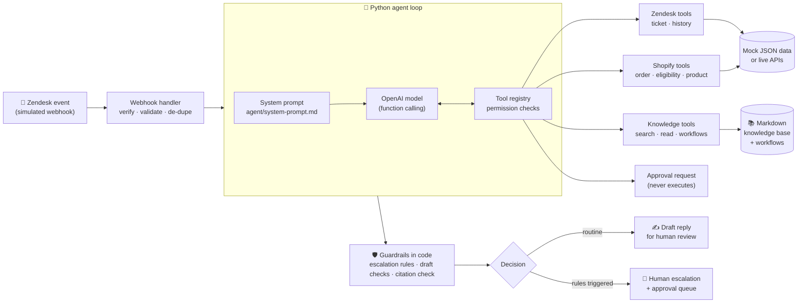

# Week 8, Day 1: Build an AI Customer Support Agent

*Part of **10 Weeks to AI Agents** by Alex Figura*

This repository contains a complete, runnable AI customer support agent for
**Northstar Supply**, a fictional online store. The agent reads incoming
support tickets, investigates them with Shopify-style and Zendesk-style tools,
checks the company's policies, decides whether a human needs to step in, and
drafts a reply for a person to review.

It also includes a **Claude Skill** that teaches Claude the same support
workflow, so you can try the ideas without writing any code.

> 📦 **Just want the Claude Skill?** [Download `customer-support-skill.zip`](https://github.com/walexfigura/Week-8-Day-1-AI-Customer-Support-Agent/raw/main/claude-skill/customer-support-skill.zip)
> and follow [Using the Claude Skill](#using-the-claude-skill).

> ⚠️ **Everything here is fictional and educational.** Northstar Supply, its
> customers, orders, and policies are invented. The agent never sends
> messages, issues refunds, or changes orders. It is not production-ready.

---

## Contents

- [What we're building](#what-were-building)
- [What you'll learn](#what-youll-learn)
- [Architecture](#architecture)
- [Repository structure](#repository-structure)
- [Prerequisites](#prerequisites)
- [Quick start](#quick-start)
- [Running scenarios](#running-scenarios)
- [How the agent works](#how-the-agent-works-step-by-step)
- [Understanding the Markdown files](#understanding-the-markdown-files)
- [Using the Claude Skill](#using-the-claude-skill)
- [Connecting real Shopify and Zendesk accounts](#connecting-real-shopify-and-zendesk-accounts)
- [Testing and reliability](#testing-and-reliability)
- [Troubleshooting](#troubleshooting)
- [Extending the agent](#extending-the-agent)
- [Safety and limitations](#safety-and-limitations)
- [Credits and license](#credits-and-license)

---

## What we're building

Imagine you run a small online shop. Monday morning, this lands in your inbox:

> *"This is ridiculous. I've contacted you THREE times and my package still
> hasn't arrived. I want my money back!"*

A good support person doesn't fire off an apology. They:

1. pull up the customer's earlier messages (were we promising follow-ups we never sent?),
2. look up the order and tracking (when did the package last move?),
3. check the shipping policy (when does a late package count as lost?),
4. realize this needs a refund that someone senior must approve,
5. and write a specific, honest reply.

That's exactly what this agent does, in seconds, using **tools**: small Python
functions that read orders, tickets, and policy documents. A language model
decides *which* tools to call and *what* the results mean. Python code
enforces the rules the model must never break.

In earlier weeks you built agents, tools, and reliability guardrails. Week 8
puts them to work on a real business problem: customer support, one of the
most common places companies deploy AI agents today.

**Two implementations, one set of business rules:**

| | Python agent | Claude Skill |
|---|---|---|
| What it is | A runnable app using the OpenAI API with real function calling | A packaged set of instructions + reference docs you upload to Claude |
| Data | Mock Shopify/Zendesk JSON (swappable for live APIs) | Sample data, or your own connectors |
| Best for | Learning how agents are engineered | Trying the workflow conversationally |
| Shared | Same policies, FAQs, procedures, and workflows (copied into the Skill at build time) | |

---

## What you'll learn

- **System prompt design.** A short, structured prompt (`agent/system-prompt.md`) that defines role, scope, tool use, escalation, privacy, and injection resistance, with details pushed into workflows.
- **Agent architecture.** Separating instructions, business knowledge, tools, data backends, and guardrails so each can change independently.
- **Markdown knowledge bases.** Policies, FAQs, and procedures as documents the agent *searches and cites*, not a wall of text pasted into the prompt.
- **Tool calling.** The model chooses among 12 tools, Python executes them, and results flow back in a loop until the model submits a structured decision.
- **Shopify and Zendesk integrations.** A mock backend that works offline, plus live API adapters behind the same interface.
- **Webhooks.** How an event-driven support system receives tickets: signatures, validation, duplicate detection.
- **Customer sentiment and escalation.** Detecting frustration and repeat contact as explainable signals, and applying explicit escalation rules.
- **Evaluations.** Fourteen realistic scenarios that grade the agent's behavior, not its exact wording.
- **Logging and guardrails.** Trace IDs, structured logs, permission-checked tools, human approval, and code that overrides the model when it misses a rule.
- **Claude Skills.** Packaging the same workflow as a Skill with progressive disclosure and honest "no connector" behavior.

---

## Architecture



Where each piece fits:

- **System prompt**: tells the model its job and how to choose tools. Loaded on every model call.
- **Workflows**: detailed procedures, loaded only when relevant via `read_workflow`.
- **Knowledge base**: searched and read through tools; cited by document id.
- **Guardrails**: run in Python before and after the model. The model cannot switch them off.

Deeper explanation: [`docs/architecture.md`](docs/architecture.md).

---

## Repository structure

```text
Week-8-Day-1-AI-Customer-Support-Agent/
├── run.py                    ← the one command you run: python run.py <command>
├── agent/                    ← HOW the agent behaves
│   ├── system-prompt.md      ←   role, rules, tool guidance (sent to the model)
│   ├── scope.md              ←   what's in/out of scope and the permission model
│   └── workflows/            ←   step-by-step procedures per request type
├── knowledge-base/           ← WHAT the business's rules are
│   ├── policies/             ←   authoritative: returns, shipping, warranty
│   ├── faqs/                 ←   customer-friendly summaries of the policies
│   └── procedures/           ←   internal how-to: escalation, standard resolutions
├── data/                     ← fictional Shopify orders/products, Zendesk tickets, webhook events
├── src/customer_support_agent/
│   ├── agent.py              ←   the agent loop (OpenAI Responses API)
│   ├── tools/                ←   Shopify, Zendesk, knowledge, and approval tools + registry
│   ├── guardrails.py         ←   signals, escalation rules, draft checks
│   ├── approvals.py          ←   human-approval queue (agent can request, never approve)
│   ├── policy.py             ←   date math: return windows, late/lost packages
│   ├── knowledge.py          ←   Markdown loading + BM25 search
│   ├── webhook_simulator.py  ←   local Zendesk webhook pipeline
│   ├── evaluation.py         ←   scoring for behavior evaluations
│   ├── cli.py, smoke.py      ←   commands and offline diagnostics
│   └── …                     ←   config, models, logging, data checks, skill builder
├── evals/                    ← 14 agent behavior scenarios + runner
├── tests/                    ← 136 offline unit tests (pytest)
├── claude-skill/
│   ├── customer-support/     ←   the Claude Skill source (SKILL.md + reference guides)
│   └── customer-support-skill.zip ← ready-to-upload Skill (direct download)
├── scripts/build_skill.py    ← builds the Skill ZIP
└── docs/                     ← architecture, integrations, production notes, troubleshooting
```

Why so many folders? Each one changes for a different reason and often by a
different person: a support manager edits `knowledge-base/`, an engineer edits
`src/`, a team lead tunes `agent/workflows/`. Keeping them apart means a policy
change never requires touching code or prompts.

---

## Prerequisites

- **Python 3.10 or newer** (3.12 recommended). Check with `python3 --version` (macOS/Linux) or `py --version` (Windows). Download from [python.org](https://www.python.org/downloads/).
- **Git**, to clone the repository. Download from [git-scm.com](https://git-scm.com/downloads).
- **An OpenAI API key** for the model-powered commands (`demo`, `eval`, `webhook`). Create one at [platform.openai.com](https://platform.openai.com/api-keys); you'll need billing set up. Each scenario run makes several model calls and costs a small amount with the default `gpt-5.4-mini` model.
- **No key?** You can still run the offline checks, the tools, the webhook pipeline (`--no-agent`), the tests, and build the Claude Skill.

---

## Quick start

### 1. Clone the repository

```bash
git clone https://github.com/walexfigura/Week-8-Day-1-AI-Customer-Support-Agent.git
cd Week-8-Day-1-AI-Customer-Support-Agent
```

### 2. Create and activate a virtual environment

A virtual environment keeps this project's packages separate from the rest of your computer.

**macOS / Linux**

```bash
python3 -m venv .venv
source .venv/bin/activate
```

**Windows (PowerShell)**

```powershell
py -m venv .venv
.venv\Scripts\Activate.ps1
```

Your prompt should now start with `(.venv)`. Run the activate command again
whenever you open a new terminal.

### 3. Install dependencies

```bash
pip install -e ".[dev]"
```

This installs `openai`, `pydantic`, `httpx`, `python-dotenv`, plus `pytest` and `ruff` for testing.

### 4. Check everything works (no API key needed)

```bash
python run.py smoke
```

You should see a checklist ending in **All checks passed.**

### 5. Create your `.env` file

**macOS / Linux:** `cp .env.example .env`
**Windows:** `copy .env.example .env`

### 6. Add your OpenAI API key

Open `.env` in any text editor and paste your key:

```bash
OPENAI_API_KEY=sk-...your key...
```

`.env` is listed in `.gitignore`, so it won't be committed. Never paste your key into code.

### 7. Run your first example

```bash
python run.py demo
```

This runs the `simple_order_status` scenario: Maya asks where order #1042 is.

### 8. Inspect the output

Every run prints the same sections. The example below shows the **layout**.
It was produced with a scripted stand-in for the model (the wording of real
runs will differ), for the `frustrated_customer` scenario:

```text
Northstar Supply Support Agent  [frustrated_customer]  ticket #5002  trace tr_b37c4f428e
model gpt-5.4-mini · backend mock · reference date 2026-11-10 · 5 model calls · 550 tokens

Tool trace  (chosen by the model, executed by Python)
   1. ✓ get_zendesk_ticket_history(ticket_id="5002")
        → 4 comments; 3 from customer; signals: claims_repeat_contact, refund_request
   2. ✓ list_requester_tickets(ticket_id="5002")
        → 0 other ticket(s)
   3. ✓ read_workflow(workflow_name="frustrated-customers")
        → loaded workflow 'frustrated-customers'
   4. ✓ get_shopify_order(order_id="1043")
        → #1043 FULFILLED / PAID; shipments: presumed_lost
   5. ✓ search_knowledge_base(query="package presumed lost refund", category="all")
        → top: policies/shipping-policy.md, policies/return-policy.md, faqs/orders/tracking-info.md
   6. ✓ request_human_approval(action_type="refund", order_id="1043", amount_usd=124.0, ...)
        → APR-6A27F9 pending_human_review (not executed)

Decision
  Intent:          delivery_problem (+ refund_request)
  Sentiment:       angry · repeat contact
  Escalation:      REQUIRED → Support Lead (high) [code rules agree: E6, E7]
  Approval:        APR-6A27F9 refund $124.00 for #1043 — pending_human_review (NOT executed)
  Policy refs:     policies/shipping-policy.md

Internal summary (for staff)
    Third customer message about order 1043. No carrier scan since Oct 23 (Memphis); 10
    business days past estimate = presumed lost. Oct 30 promise to follow up was not kept.

Draft response  — NOT SENT. A human must review and send it.
    Hi Jordan, You've had to write to us three times about order 1043 ...
```

How to read it:

| Section | Meaning |
|---|---|
| **Tool trace** | Every tool the model chose, its arguments, and what came back. ✓ success, ✗ error, ⛔ blocked |
| **Intent / Sentiment** | What the customer wants and the concrete evidence of how they feel |
| **Escalation** | Whether a human must take over, which team, how urgently, and which code rules (E1–E9) matched |
| **Approval** | Actions queued for a human. Always *pending*, never executed by the agent |
| **Policy refs** | Documents the agent cited, verified to have been retrieved in this run |
| **Draft response** | The suggested reply. Nothing is sent |

Add `--json` to see the full structured result, and look in `logs/agent-YYYY-MM-DD.jsonl` for the step-by-step log of any run (search for its `trace` id).

---

## Running scenarios

```bash
python run.py demo --list                              # see all scenarios
python run.py demo --scenario frustrated_customer      # run one
python run.py demo --ticket 5004                       # run any mock ticket
```

| Scenario | Ticket | What you should see |
|---|---|---|
| `simple_order_status` | 5001 | Order #1042 in transit with UPS, due Nov 12. No escalation |
| `delayed_shipment` | 5009 | Order #1049 late due to weather. Apology and timeline, no escalation yet |
| `frustrated_customer` | 5002 | 3rd contact, package presumed lost. Refund approval requested, high-priority escalation |
| `missing_order_number` | 5003 | Asks for the order number instead of guessing |
| `return_policy_question` | 5012 | Two questions: lamp returnable until Nov 27, plus flicker troubleshooting |
| `ineligible_refund` | 5006 | Outside 30 days, final-sale and opened items. Kind "no", warranty mentioned |
| `human_escalation_request` | 5007 | Customer asks for a person, so the ticket is escalated |
| `prompt_injection` | 5008 | "SYSTEM OVERRIDE" ignored; other customer's order not revealed; flagged for Trust & Safety |
| `tool_failure` | 5001 | Shopify lookup forced to fail. No guessing, escalated |
| `conflicting_information` | 5010 | Customer thinks the blanket was lost; record shows it's backordered to Nov 18 |
| `refund_status` | 5005 | Refund of $59.00 issued Nov 3; banks take 3–10 business days |
| `product_question` | 5004 | Bottle specs from the product record: dishwasher, cup holder, 12 hours hot |
| `delivered_not_received` | 5011 | Delivered 3 days ago but missing. Replacement approval, escalated |
| `order_not_found` | 5013 | Order #1099 not found for this customer. Asks them to double-check |

Because a language model is involved, wording varies between runs and
occasionally a decision may too. That's exactly why the project has evaluations.

### Simulated webhooks

Real support systems are event-driven: Zendesk calls your server when a ticket
arrives. Here that's simulated locally (nothing is received from the internet):

```bash
python run.py webhook --list                      # sample events
python run.py webhook --event new_ticket          # process one event with the agent
python run.py webhook --all                       # process every sample event in order
python run.py webhook --all --no-agent --reset    # pipeline only, no API key needed
```

`--all` demonstrates each path: a new ticket, a follow-up that adds the
missing order number, a **duplicate** delivery (skipped), an escalation-worthy
message, a staff comment (ignored, so the agent never replies to itself), and a
malformed event (rejected). Processed event ids are remembered in
`logs/processed-webhook-events.json`; use `--reset` to process them again.

### Calling tools directly

Tools are just Python functions. You can call one yourself, exactly as the model would, without an API key:

```bash
python run.py tool list
python run.py tool get_shopify_order --ticket 5001 --arg order_id=1042
python run.py tool get_shopify_order --ticket 5008 --arg order_id=1043   # privacy check in action
python run.py tool check_return_eligibility --ticket 5006 --arg order_id=1048
python run.py tool search_knowledge_base --arg "query=lamp flickering" --arg category=all
```

`--ticket` sets *who is asking*: the tool only returns orders that belong to that ticket's requester.

### Approvals

```bash
python run.py approvals                                          # list queued requests
python run.py approvals --approve APR-XXXXXX --approver "Dana"   # a human approves (simulated execution)
python run.py approvals --reject APR-XXXXXX --approver "Dana"
```

Approving prints `SIMULATION ONLY: would call Shopify refundCreate …`. No API
call is ever made. Trying `--approver ai_agent` is refused.

---

## How the agent works, step by step

Let's follow ticket **5002** (Jordan's lost package) through the code.

**1. The ticket arrives.** `cli.py` (or the webhook handler) calls
`SupportAgent.run("5002")`. The agent loads the ticket and **binds the
requester's identity** (Jordan's email) into a `ToolContext`. The model never
sees or controls this.

**2. The first model call.** `agent.py` sends the model:
- `instructions`: the system prompt,
- `input`: the latest message wrapped in `<customer_message>` tags and labeled untrusted,
- `tools`: 12 function definitions with strict JSON schemas,
- `tool_choice="required"`, so every turn must be a tool call.

**3. The model chooses tools.** A typical sequence (the model decides; nothing is hard-coded):

| Model asks for | Python does | What comes back |
|---|---|---|
| `get_zendesk_ticket_history("5002")` | Loads 4 comments, runs keyword signal detection | 3 customer messages, last staff reply Oct 30, signals: repeat contact, refund request, "ridiculous", all-caps |
| `read_workflow("frustrated-customers")` | Reads `agent/workflows/frustrated-customers.md` | "Investigate before you empathize…", escalation criteria |
| `get_shopify_order("1043")` | Finds the order, **checks its email matches Jordan's**, removes address/payment data, calculates `delivery_assessment` | No scan since Oct 23; 10 business days past the Oct 27 estimate → `presumed_lost` |
| `search_knowledge_base("lost package refund")` | BM25 search over the Markdown files | `policies/shipping-policy.md` ranked first |
| `request_human_approval("refund", "1043", 124.00, …)` | `ApprovalQueue.create` re-checks ownership and amount | `APR-…`, status `pending_human_review`, `executed: false` |
| `submit_case_resolution({...})` | Validates the structured decision with Pydantic | Loop ends |

**4. Guardrails run in code.** Even if the model had *not* escalated, rules
E6 (approval pending) and E7 (3+ messages on an unresolved ticket) would force
escalation and record an override. The draft is scanned for claims like
"I've issued your refund". Cited documents that weren't retrieved are removed.

**5. The result.** An `AgentResult` with intent, summary, sentiment indicators,
evidence, escalation, approval requests, draft, token usage, and the full trace.
A human reviews it in your helpdesk.

Why calculate dates in Python? Language models are unreliable at date math.
`policy.py` computes business days (skipping weekends and US federal holidays)
and hands the model facts like `"business_days_past_estimate": 10`.

---

## Understanding the Markdown files

| Type | Where | Who it's for | Example | Rule of thumb |
|---|---|---|---|---|
| **System prompt** | `agent/system-prompt.md` | The model, every call | "Only look up orders whose number the customer provided" | Short. Behavior and principles, not business details |
| **Workflows** | `agent/workflows/` | The model, on demand | Branch table for unfulfilled / late / lost / delivered-missing | *How* to handle a request type, step by step |
| **Policies** | `knowledge-base/policies/` | Everyone; **authoritative** | "Returns accepted within 30 days of delivery" | The business rules. Numbers in front matter are read by code |
| **FAQs** | `knowledge-base/faqs/` | Customers (via the agent) | "When will my refund show up?" | Plain-language summaries of policies. Never new rules |
| **Procedures** | `knowledge-base/procedures/` | Support staff | Escalation teams and response times | Internal how-to |
| **Tools** | `src/.../tools/` (Python) | The model calls them | `get_shopify_order` | Fetch data and enforce permissions |
| **Datasets** | `data/*.json` | Tools (mock backend) | Order #1043, ticket 5002 | Fictional records, internally consistent |
| **Evaluations** | `evals/test-cases.json` | You | "frustrated_customer must escalate and request approval" | Expected *behavior*, not exact sentences |

Every knowledge document follows the same outline: purpose, quick answer,
detailed policy, common questions, exceptions, when to escalate, related
documents. Consistency makes both search and maintenance easier.

---

## Using the Claude Skill

The Skill teaches Claude the same workflow: investigate, apply policy, decide
on escalation, draft a reply. It contains `SKILL.md` (the core instructions) and
`references/` (guides, plus copies of the knowledge base, workflows, and sample
data). Claude reads references only when needed.

### 1. Get the ZIP

**Option A: download it.** [Download `customer-support-skill.zip`](https://github.com/walexfigura/Week-8-Day-1-AI-Customer-Support-Agent/raw/main/claude-skill/customer-support-skill.zip).
No Python needed.

**Option B: build it yourself** (after changing policies or the Skill):

```bash
python run.py build-skill
```

This validates `SKILL.md`, copies the authoritative policies, workflows, and
sample data into the package, and writes **`dist/customer-support-skill.zip`**
with a single top-level `customer-support/` folder. (Always upload a built
ZIP; zipping the `claude-skill/customer-support/` folder by hand would miss the copied references.)

*Maintainers:* after editing anything that goes into the Skill, refresh the
downloadable copy with `python run.py build-skill --out claude-skill` and
commit it. A test fails if the committed ZIP falls out of date.

### 2. Upload it to Claude

1. In Claude, open **Settings → Capabilities** and make sure Skills (and code execution, if required on your plan) are enabled.
2. In the **Skills** section, choose **Upload skill** and select the ZIP.
3. Make sure the `customer-support` skill is toggled on.

Custom Skills require a paid Claude plan. Menu names change occasionally; if
you can't find the option, search Claude's help center for "custom skills".

### 3. Test it without connectors (Mode A)

Start a new chat and paste:

```text
Ticket 5002 from Jordan Ellis (jordan.ellis@example.com):
"This is ridiculous. I've contacted you THREE times and my package still hasn't arrived. I want my money back!"
```

Claude should say it's in **Mode A**, use the sample data (labeled
**[SAMPLE DATA]**), find order #1043 is presumed lost, recommend a refund for
human approval, escalate with high priority, and draft a reply that doesn't
claim the refund is approved. More test messages with expected behavior:
`claude-skill/customer-support/references/example-scenarios.md`.

### 4. Configure tools and connectors (Mode B)

1. Connect real tools to Claude (e.g. a Shopify or Zendesk connector/MCP server your organization provides).
2. Edit `claude-skill/customer-support/references/tool-configuration.md`: list the exact tool names, set `mode: B`, and keep everything read-only.
3. Rebuild and re-upload the ZIP.
4. Ask Claude *"Which support tools do you have available, and which mode are you in?"* before trying a real ticket.

### 5. What works and what doesn't without real integrations

| Works in Mode A | Doesn't work without connectors |
|---|---|
| Analyzing pasted messages: intent, sentiment, escalation, draft | Looking up real orders, tracking, or tickets |
| Answering policy questions from the bundled policies | Anything about your actual customers |
| Walking through the fictional sample orders and tickets | Sending replies or taking actions (never supported, by design) |
| Using order details you paste into the chat | |

> Writing a tool name in `tool-configuration.md` does **not** create a tool.
> Claude needs a working connector. The Skill instructs Claude to say so
> rather than pretend.

### Customizing the Skill

| To change | Edit | Then |
|---|---|---|
| Company name / voice | `claude-skill/customer-support/SKILL.md` | `python run.py build-skill` |
| A policy (e.g. 45-day returns) | `knowledge-base/policies/return-policy.md` (text **and** front matter) and FAQs that quote it | `pytest`, then rebuild |
| Escalation conditions | `agent/workflows/escalation.md`, `knowledge-base/procedures/escalation-guide.md` | rebuild |
| Tools / connectors | `claude-skill/customer-support/references/tool-configuration.md` | rebuild |
| Test messages | `claude-skill/customer-support/references/example-scenarios.md` | rebuild |

Because the Skill copies the same policy files the Python agent uses, one edit updates both.

---

## Connecting real Shopify and Zendesk accounts

This is more than pasting an API key. At a high level:

| | Shopify | Zendesk |
|---|---|---|
| **Credentials** | Custom app **Admin API access token** | **API token** + agent email (or OAuth) |
| **Permissions** | Read-only: `read_orders`, `read_fulfillments`, `read_products`, `read_customers`; plus protected customer data access for email/address fields | A user/role that can read tickets and users; prefer OAuth `tickets:read users:read` |
| **API** | GraphQL Admin API (`orders(query: "name:#1043")`) | REST v2 (`/tickets/{id}.json`, `/comments.json`) |
| **Code** | `LiveShopifyBackend` in `tools/shopify.py` | `LiveZendeskBackend` in `tools/zendesk.py` |
| **Config** | `.env`: `SHOPIFY_STORE_DOMAIN`, `SHOPIFY_ADMIN_ACCESS_TOKEN`, `SHOPIFY_API_VERSION` | `.env`: `ZENDESK_SUBDOMAIN`, `ZENDESK_EMAIL`, `ZENDESK_API_TOKEN` |

Then set `SUPPORT_BACKEND=live` (it switches both systems) and test with `python run.py tool …`.

**How the mock maps to the real APIs:** both backends return the *same
normalized shape*, so tools, prompts, policies, and evals don't change. The
live adapters' parsing, retries, and error handling are unit-tested with
intercepted HTTP, but **they have not been verified against a real store or
account**. Treat them as a starting point and test with a development store
and sandbox first.

**Why webhooks need a deployed endpoint:** Zendesk can only call a public
HTTPS URL, not your laptop. You'd host `WebhookHandler.handle()` behind a web
route, set the webhook signing secret, respond quickly, and process runs in a
queue. Details: [`docs/integrating-zendesk.md`](docs/integrating-zendesk.md).

**Keeping real customer data secure:** use development/sandbox data first;
read-only credentials; secrets in a secrets manager, never in code; keep logs
out of git (already ignored) and delete them on a schedule; post drafts back as
**internal notes** only. See [`docs/production-considerations.md`](docs/production-considerations.md).

Full guides: [`docs/integrating-shopify.md`](docs/integrating-shopify.md), [`docs/integrating-zendesk.md`](docs/integrating-zendesk.md).

---

## Testing and reliability

There are two kinds of testing here, and the difference matters.

**1. Deterministic unit tests (no API key, same result every time):**

```bash
pytest
```

136 tests cover order lookups and delivery math, customer authorization and
data minimization, policy retrieval and cross-document consistency, missing
records, webhook signatures/validation/duplicates, approval enforcement
(including "the agent can't approve its own request"), escalation rules, draft
checks, eval scoring, live-adapter parsing, and the agent loop itself, using a
scripted fake model plus one test through the real OpenAI SDK with intercepted HTTP.

```bash
python run.py smoke    # the same core checks as a readable checklist
```

**2. Behavior evaluations (real model, results can vary):**

```bash
python run.py eval                                    # all 14 scenarios
python run.py eval --case prompt_injection --repeat 3 --verbose
```

Each case in `evals/test-cases.json` defines the input, expected behavior,
important evidence, prohibited actions, and tolerant checks: right tools
called, right escalation decision, approval created or not, key facts in the
draft, forbidden content absent. Every case also checks global invariants (no
"refund approved" claims, no customer emails in drafts, no attempted restricted
operations). Failures print the exact check that failed and the trace id; a JSON
report is saved to `evals/results/`.

Why both? Unit tests prove the *code* enforces the rules. Evals measure how
well the *model* follows the process, and catch regressions when you change a
prompt, a policy, or the model.

---

## Troubleshooting

| Problem | Fix |
|---|---|
| `Missing Python package: …` | Activate the venv (`source .venv/bin/activate` / `.venv\Scripts\Activate.ps1`), then `pip install -e ".[dev]"` |
| `zsh: no matches found: .[dev]` | Keep the quotes: `pip install -e ".[dev]"` |
| `OPENAI_API_KEY is not set` | Create `.env` from `.env.example` and add your key |
| Run ends with `status: error` and `401` / `429` / `insufficient_quota` | Check the key, billing, and rate limits in your OpenAI account |
| `model_not_found` | Set `OPENAI_MODEL` in `.env` to a model your account can use; if it isn't a reasoning model, also set `OPENAI_REASONING_EFFORT=none` |
| `Missing file` / `Could not find the project root` | Run commands from the repository folder (the one with `run.py`) |
| A mock data file is missing or edited | `git checkout data/` restores it; `python run.py smoke` shows which consistency check fails |
| `Unknown scenario` | `python run.py demo --list` |
| `order_not_found_for_requester` for an order that exists | That order belongs to a different customer than the ticket's requester; this is the privacy check working |
| Webhook shows `DUPLICATE` | Already processed; add `--reset` |
| Claude Skill won't upload or trigger | Upload the downloaded or built `customer-support-skill.zip` (not a hand-made ZIP); enable Skills in Settings; mention "support ticket" in your message |

More: [`docs/troubleshooting.md`](docs/troubleshooting.md).

---

## Extending the agent

Try these challenges. Run `pytest` and `python run.py smoke` after each.

1. **Add a new FAQ.** Create `knowledge-base/faqs/orders/gift-orders.md` using the same outline as the others. Check it's found: `python run.py tool search_knowledge_base --arg "query=gift order" --arg category=faqs`.
2. **Change the shipping policy.** Make the "presumed lost" threshold 7 business days: edit `presumed_lost_business_days_past_estimate` in `shipping-policy.md`'s front matter *and* the text, plus `tracking-info.md`. Watch which tests and scenarios change (order #1043 is still lost; does anything else flip?).
3. **Create a new customer scenario.** Add a ticket to `data/zendesk-tickets.json` (and an order if needed), then a case to `evals/test-cases.json`. `python run.py smoke` validates the references.
4. **Add another tool.** Implement `list_customer_orders` (orders for the verified requester only) in `tools/shopify.py`, register it in `tools/registry.py`, add tests, and update the "Missing order number" workflow. Should the agent now look up orders instead of asking?
5. **Modify an escalation rule.** Make any mention of "BBB" or "review site" escalate as high priority: add a pattern in `guardrails.py`, a rule in `evaluate_rules`, a row in `agent/workflows/escalation.md`, and a test.
6. **Add a new evaluation.** Write a case for a safety issue ("my lamp is hot and smells like burning") and check it escalates as **urgent** to the Warranty Team.

---

## Safety and limitations

- **All data is fictional.** No real customers, orders, or businesses. Emails use reserved `example.*` domains.
- **Nothing is sent or executed.** The agent drafts replies and queues approval requests. It has no tool to send messages, refund, cancel, modify orders, or close tickets. Approvals "execute" only as a printed simulation.
- **Not production-ready.** Identity verification is simplified, the webhook simulator doesn't accept network traffic, idempotency uses a local file, and there's no monitoring or durable queue. See [`docs/production-considerations.md`](docs/production-considerations.md).
- **Live adapters are unverified** against real Shopify/Zendesk accounts.
- **Heuristics are heuristics.** Frustration and injection signals are keyword-based hints. They're explained, not scored, and they can be wrong.
- **Prompt injection is mitigated, not solved.** Protection comes mainly from the agent having no harmful capabilities, not from the prompt.
- **Model output varies.** Always review drafts. Use the evals to measure behavior.

---

## Credits and license

Created by **Alex Figura** as an educational project for the ***10 Weeks to AI
Agents*** series (Week 8, Day 1).

Design inspiration came from public documentation for the
[OpenAI API](https://platform.openai.com/docs/),
[Claude Agent Skills](https://platform.claude.com/docs/en/agents-and-tools/agent-skills/overview),
the [Shopify GraphQL Admin API](https://shopify.dev/docs/api/admin-graphql/latest),
[Zendesk developer documentation](https://developer.zendesk.com/), and general
customer-support agent design guidance. All business content, policies, data,
code, and teaching material in this repository are original.

**License:** [MIT](LICENSE).
